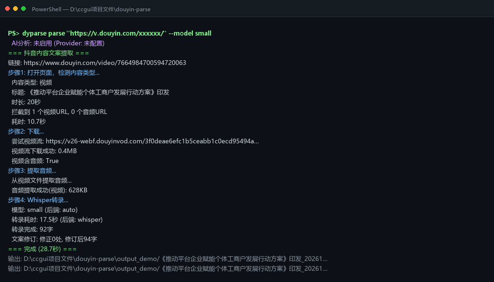

# douyin-parse

[](https://github.com/panghulo1994/douyin-parse/actions/workflows/ci.yml)
[](LICENSE)
[](https://pypi.org/project/douyin-parse/)
[](pyproject.toml)

> **PyPI**：<https://pypi.org/project/douyin-parse/> · 安装：`pipx install "douyin-parse[all]"`

把抖音分享链接变成可读的文案：`链接 → 文案.txt / 文案_分析版.md`，附带画面文字（OCR）与一段 AI 可靠性分析。

```bash
dyparse parse "https://v.douyin.com/xxxxxx/"
```

- 视频：Playwright 抓流 → FFmpeg 转 16k 单声道 → Whisper 转录 → 本地字典纠错 → RapidOCR 识屏
- 图文：直接读页面文本，不下载、不 OCR
- AI 可选：标点恢复 + 可靠性分析（任意 OpenAI 兼容接口），不配也能跑



> 上图是一次真实运行：20 秒短视频，全本地模式（`--ai none --no-ocr`）。

## 安装

需要 Python 3.10+ 和 ffmpeg。

```bash
# 推荐：隔离安装
pipx install "douyin-parse[all]"

# 或者用 uv
uv tool install "douyin-parse[all]"

# 也可以直接装进当前环境
pip install "douyin-parse[all]"

# 开发模式
git clone https://github.com/panghulo1994/douyin-parse.git
cd douyin-parse && pip install -e ".[all]"
playwright install chromium   # 非 Windows 或没装 Chrome 时需要
```

`[all]` 会带上 whisper 和 OCR 依赖；不想装那么多就只装 `douyin-parse`，
再按需补 `pip install faster-whisper`。

转录后端二选一，**推荐 faster-whisper**（CPU 快 3–4 倍，不用装 torch）：

```bash
pip install faster-whisper     # 约 300 MB
# 或
pip install openai-whisper     # 会带入 torch，约 2.5 GB
```

`dyparse doctor` 会告诉你当前能用哪个。

装完先自检：

```bash
dyparse doctor
```

## 用法

```bash
dyparse parse "https://v.douyin.com/xxxx/"            # 单条
dyparse parse "https://v.douyin.com/xxxx/" -v         # 强制按视频解析
dyparse parse "https://v.douyin.com/xxxx/" --ai none  # 全本地，不调用 AI
dyparse batch links.txt                               # 批量，一行一个链接
dyparse transcribe ./a.mp4                            # 本地文件，不联网、不开浏览器
dyparse config --init                                 # 生成 .env 模板
```

常用参数：

| 参数 | 说明 | 默认 |
| --- | --- | --- |
| `--out DIR` | 输出根目录 | `./output` |
| `--model NAME` | `tiny/base/small/medium/large-v3` | `small` |
| `--no-ocr` | 跳过画面文字提取 | 不跳过 |
| `--ai auto\|none\|deepseek\|mimo` | AI 供应商 | `auto` |
| `--auto-number` | 按修改时间给输出目录统一编号 | 关 |
| `--backend NAME` | `auto/faster-whisper/whisper` | `auto` |
| `--headless` | 无头浏览器（服务器用） | 关 |
| `--proxy URL` | 代理，如 `http://127.0.0.1:7890` | 无 |
| `--user-agent UA` | 自定义 UA | 浏览器默认 |
| `-v, --force-video` | 图文被误判时强制视频流程 | 关 |

也可以用环境变量：`DOUYIN_OUTPUT_BASE` / `DOUYIN_WHISPER_MODEL` / `DISABLE_VIDEO_OCR` / `DOUYIN_AI_PROVIDER` / `AI_API_URL` / `AI_API_KEY` / `AI_MODEL`。

Windows 上密钥只存在「用户环境变量」里也能读到（不需要重启终端）。

## 给 Agent 用（可选）

**项目记忆**：仓库根目录的 [AGENTS.md](AGENTS.md) 写了架构地图、命令、约定和已知坑，
Codex / Cursor / DSH 等会直接读取；Claude Code 通过 [CLAUDE.md](CLAUDE.md) 导入同一份内容。

**技能**：`skills/douyin-parse/SKILL.md`，复制到你的技能目录即可：

- Claude Code：`~/.claude/skills/douyin-parse/`
- DSH：`~/.dsh/skills/douyin-parse/`

skill 只约定「什么时候调用、怎么汇报」，解析仍然由 `dyparse` 完成。

## 产出

每条内容一个文件夹（`{标题}_{YYYYMMDD}`）：

| 文件 | 内容 |
| --- | --- |
| `文案.txt` | 修订、加标点后的纯正文 |
| `文案_分析版.md` | 标题 + 元信息表 + 正文 + AI 可靠性分析 |
| `画面文字.md` | 视频画面 OCR 出来的文字（有结果时） |
| `修订报告.md` | ASR 字典修正记录（有修正时） |
| `info.json` | 元数据 + 原始转录 + 分析 + OCR 文本 |
| `audio.wav` | 16kHz 单声道音频 |

## 速度

CPU 上实测（30 分钟视频，i9-14900HX）：

| 模型 | 体积 | 转录耗时 |
| --- | --- | --- |
| `small` | ≈460 MB | 约为音频时长的 0.6 倍 |
| `large-v3` | ≈2.9 GB | 约为音频时长的 1.7 倍（30 分钟视频 ≈ 50 分钟） |

长视频建议 `--model small`；追求准确度再用 `large-v3`。

## 平台

- Windows：默认调用系统 Chrome（`DOUYIN_BROWSER_CHANNEL=chrome`），窗口会自动最小化
- macOS / Linux：需要 `playwright install chromium`，窗口最小化自动跳过
- 无图形界面服务器：加 `--headless`（抖音可能对无头浏览器更敏感，失败就换回有头）

## 现状

v0.1 把原先的单文件脚本拆成了模块：

```text
cli / config / pipeline / extract / transcribe / ocr / media / browser
ai / render / correct / naming / batch / local / doctor
```

已完成：`dyparse` 命令行、跨平台配置目录、`doctor` 自检、单元测试、
faster-whisper 后端、本地文件模式、`--headless`。

尚未完成：

- [ ] 失效自动检测（页面结构改版时给出明确提示）
- [ ] 图形界面

发布流程（PyPI + Trusted Publishing）见 [docs/发布.md](docs/发布.md)。
- [ ] 更多平台适配与失效自动检测

## 许可与免责声明

MIT。仅供个人学习与研究使用。

抓取行为可能违反平台用户协议，且会随平台改版失效；产出的文案、画面文字版权归原作者，
请勿再分发或用于商业用途。
